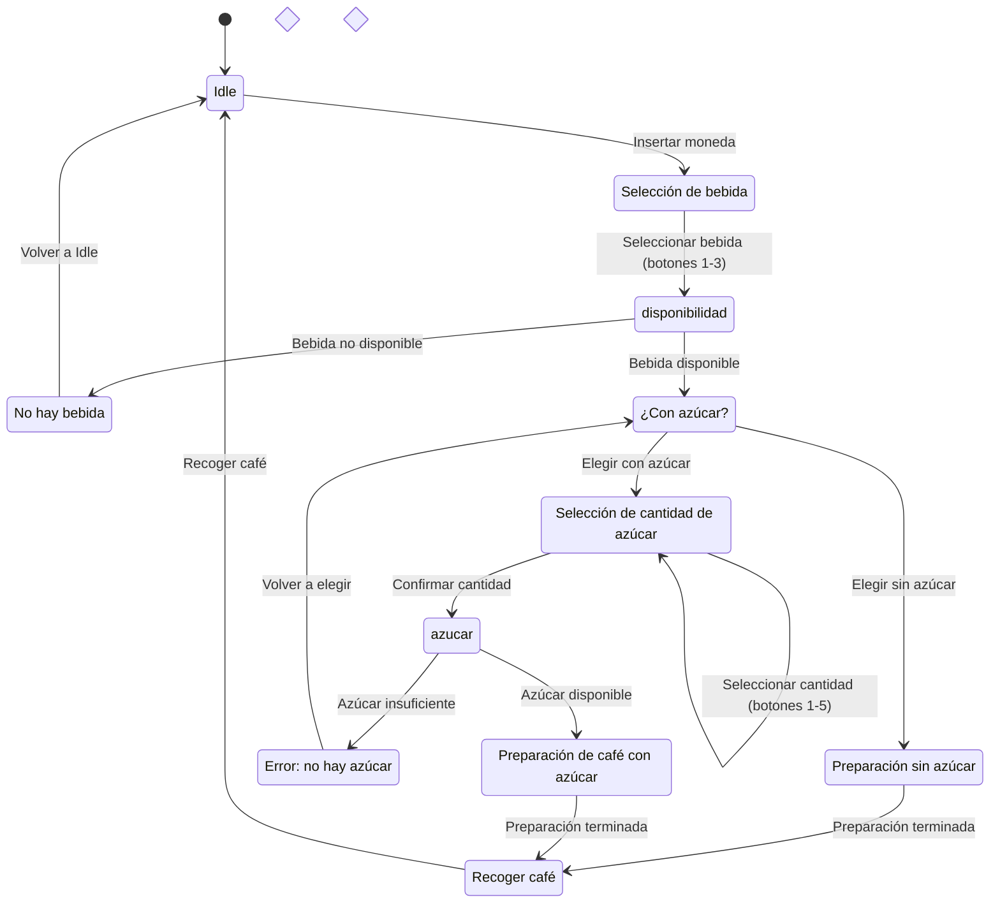

### Estados

| Código | Nombre |
|---|---|
| E1 | Idle |
| E2 | Selección de bebida |
| E3 | No hay bebida |
| E4 | ¿Con azúcar? |
| E5 | Preparación sin azúcar |
| E6 | Selección de cantidad de azúcar |
| E7 | Error: no hay azúcar |
| E8 | Preparación de café con azúcar |
| E9 | Recoger café |
| — | Comprobación de disponibilidad |
| — | Comprobación de azúcar |

### Transiciones

| Estado de origen | Transición / condición | Estado de destino |
|---|---|---|
| Inicio | Inicio del sistema | E1: Idle |
| E1: Idle | Insertar moneda | E2: Selección de bebida |
| E2: Selección de bebida | Seleccionar bebida (botones 1-3) | Comprobación de disponibilidad |
| Comprobación de disponibilidad | Bebida no disponible | E3: No hay bebida |
| Comprobación de disponibilidad | Bebida disponible | E4: ¿Con azúcar? |
| E3: No hay bebida | Volver a Idle | E1: Idle |
| E4: ¿Con azúcar? | Elegir sin azúcar | E5: Preparación sin azúcar |
| E4: ¿Con azúcar? | Elegir con azúcar | E6: Selección de cantidad de azúcar |
| E6: Selección de cantidad de azúcar | Seleccionar cantidad (botones 1-5) | E6: Selección de cantidad de azúcar |
| E6: Selección de cantidad de azúcar | Confirmar cantidad | Comprobación de azúcar |
| Comprobación de azúcar | Azúcar insuficiente | E7: Error: no hay azúcar |
| Comprobación de azúcar | Azúcar disponible | E8: Preparación de café con azúcar |
| E7: Error: no hay azúcar | Volver a elegir | E4: ¿Con azúcar? |
| E5: Preparación sin azúcar | Terminar preparación | E9: Recoger café |
| E8: Preparación de café con azúcar | Terminar preparación | E9: Recoger café |
| E9: Recoger café | Retirar café | E1: Idle |